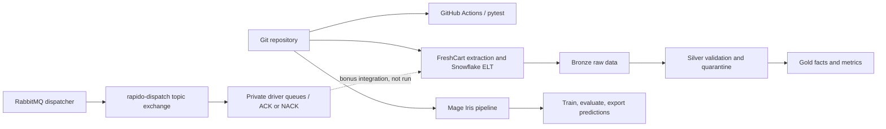

# From Git to Gold — Report Draft (not submission-ready)

**Student:** `[Roll number and full name required]`
**GitHub repository:** `[URL required; nothing has been pushed]`
**Evidence status:** This draft contains local test output and assignment-provided expectations only. Snowflake, Mage, GitHub Actions, and live RabbitMQ execution evidence/screenshots are not available. Do not submit this draft as a completed report.

## Part A — Git and CI/CD

### A1. Repository and commits

The local repository contains the root project files, `elt/`, `iris_project/`, `stream/`, `tests/`, and `.github/workflows/ci.yml`. Six commits are present locally. The current commit authors are `Copilot <copilot@example.com>`, a setup placeholder—not the student's identity. Do not amend existing history without authorization; configure the student's real name/email before future commits. No remote URL is configured or push made.

```text
9d127e4 Fix local pytest import path
ffb8518 Document assignment checklist and manual actions
660b90b Add RabbitMQ stream scaffold and ELT placeholders
78ec9f2 Implement deterministic iris preprocessing
101fd1e Add CI workflow and pytest test
eacc55b Initialize repository scaffold
```

The `.gitignore` excludes `.env`, `*.pkl`, `*.csv`, `mage.log`, `__pycache__`, and common Python/notebook cache artifacts.

### A2. Where Git commands act

| Command | Where the change happens | What exactly happens |
|---|---|---|
| `git init` | Current working folder | Creates the local `.git` repository metadata; it does not upload project files. |
| `git add train.py` | Local staging area | Stages the current contents of `train.py` for the next commit. |
| `git commit -m "msg"` | Local repository | Records a snapshot of staged changes in local Git history. |
| `git remote add origin URL` | Local repository configuration | Stores a named URL for a remote repository; it does not transfer commits. |
| `git push -u origin main` | Remote GitHub repository | Uploads local `main` commits to `origin` and configures upstream tracking. |
| `git pull origin main` | Local repository and working folder | Fetches remote `main` and integrates it into the current branch, possibly creating conflicts. |

After `git commit`, a teammate cannot see the code on GitHub unless the commit is pushed to a remote they can access.

### A3. CI and test evidence

The workflow at `.github/workflows/ci.yml` runs for pushes, checks out the code, sets up Python 3.12, installs `requirements.txt`, and runs `pytest -q`. The local required split test passes with the deterministic 120/30 split. The requested red demonstration was performed locally by temporarily setting `test_size=0.3`; pytest failed, and after restoring `0.2` it passed. The latest full local suite and syntax results are recorded in `ASSIGNMENT_CHECKLIST.md`. **No GitHub Actions run or screenshots are available**, so remote CI is not verified. Attach actual red and green Actions screenshots after pushing with permission.

## Part B — FreshCart ELT on Snowflake

### B1. Baseline

The assignment-provided expected values (not observed execution) are: bronze 8 rows (6 web + 2 mobile), cleaned silver 6, quarantine 2 (ORD-1004 and ORD-1006), deduplicated 4, gold 4 orders, revenue 7,785.00, loyalty points 126, rejected share 25%. The supplied Python/SQL source is integrated under `elt/`; the original notebook and Snowflake access are missing. Two isolated local `--dry-run --mock` extraction runs succeeded: baseline mode (`--baseline-crm`) produced 6 web, 2 mobile, 4 CRM, and 1 FX records; B4 event mode (without `--baseline-crm`) produced 6 web, 2 mobile, 5 CRM, and 1 FX records. The temporary landing outputs were removed; neither run loaded or transformed Snowflake data.

The local behavior tests derive Bronze/Silver/quarantine/dedup/Gold counts, rejected share, and baseline revenue/points from the source fixtures rather than hardcoding intermediate calculation inputs. In `tests/test_freshcart_source.py`, tests are labelled by docstrings as fixture/data validation, Python unit tests/local models, or static SQL checks; there are no Snowflake integration tests. The row-fingerprint and merge behavior tests are local models backed by static SQL assertions; they do not execute Snowflake `HASH` or `MERGE`. The full suite under Python 3.12.10 reported **27 passed in 4.28s**. All seven SQL files received manual syntax/function review, but no SQL compiler or Snowflake validation was run. Actual Snowflake results and screenshots are **NOT RUN**.

The configured interpreter is Python 3.12.10. The fixture tests use `datetime.strptime`, `datetime.fromisoformat`, and `date.fromisoformat`, which are available in Python 3.12; the course-format date `Sep 3, 2026` was checked with that interpreter.

The custom web/mobile/CRM API URLs are environment-configured, and the supplied source files do not document their authentication scheme. The implementation constructs a Bearer authorization header; a dummy-token unit test verifies that construction only. It cannot confirm those services accept Bearer auth. The Frankfurter and India Post calls are unauthenticated in the integrated extractor.

### B2. ORD-1003 / ORD-1005 trace

In extracted `mock_data.py`, the web record uses `order_id`, `cust_email`, `cust_name`, `order_date`, `amount`, `currency`, `pincode`, and `updated_at`; the mobile record uses `orderId`, nested `customer.email/name`, `orderDate`, nested `total.value/currency`, `deliveryPin`, and `updatedAt`. `sql/10_silver_orders_clean.sql` maps both JSON forms into common columns, normalizes email/currency, parses dates and timestamps, and strips amount formatting. `sql/20_silver_orders_dedup.sql` keeps `ROW_NUMBER() = 1` per `order_id`, ordered by `updated_at DESC, ingest_seq DESC`, so the later mobile ORD-1003 record ranks first.

Gold uses the point-in-time join `o.order_date BETWEEN c.valid_from AND c.valid_to` on normalized email, then `m.tier = c.tier` to join `ref.tier_multiplier`. The extracted multiplier values are Silver 1, Gold 2, Platinum 3. ORD-1003 calculates INR 2,100.00 (`ROUND(2100 * 1.0, 2)`) and 63 points (`FLOOR(2100 / 100) * 3`). Priya's ORD-1005 (2026-09-03) is Gold: `FLOOR(899 / 100) * 2 = 16`; ORD-1001 (2026-09-01) is Silver: `FLOOR(1250 / 100) * 1 = 12`. These are calculations from extracted mock values and SQL, not Snowflake output.

### B3. Unsupported currency

The preserved source copy's SQL lacked the currency reason; the integrated `elt/sql/10_silver_orders_clean.sql` now includes `IFF(currency IS NULL OR currency NOT IN ('INR', 'USD'), 'unsupported_currency', NULL)` inside `ARRAY_CONSTRUCT_COMPACT(...)`. The `typed` CTE already uppercases currency. For ORD-1006, source logic gives `bad_email` and `bad_pincode` before the rule; the integrated rule adds `unsupported_currency`. It remains excluded from `silver.orders_clean`, so the rule alone should not change gold totals. This is source-derived reasoning, not a Snowflake result.

The quarantine insert has a `NOT EXISTS` check on matching `source`, `EQUAL_NULL(order_id)`, and `EQUAL_NULL(updated_at)` from `row_data`, plus a `QUALIFY ROW_NUMBER()` on source/order/update timestamp. That condition is designed to avoid another insert for the same source record version; no second Snowflake run was made to verify it. Local tests independently derive the two fixture rows' validation reasons, but do not execute the quarantine SQL.

### B4. SCD2 and idempotency

The integrated mock preserves the baseline CUST-02 Silver event effective 2024-01-15 and adds the requested Gold event effective 2026-08-15. `--baseline-crm` selects baseline inputs; omit it for the Part B4 event run. Fill the prediction column yourself before running; actual output remains NOT RUN. The extracted SCD2 SQL partitions duplicate events by customer and effective date and sets each period's end to one day before the next event. Local tests verify the event's inclusive effective-date behavior, tier-dependent row fingerprints, and unchanged-row no-republish behavior; static assertions check the SQL hash inputs and merge predicate. These tests do not execute Snowflake's `HASH` or `MERGE`. Bronze grows by eight order rows when each run creates new landing filenames, even though COPY can skip reloading the same staged filename.

### B5. Quality check and ETL/ELT

The supplied runner had six checks. The integrated `quality_checks()` adds the assignment-approved gold amount-present/INR-conversion-missing check as a seventh overall check, without deleting supplied checks. The query and failure path are tested with a mocked connector. To finish B5, make it fail with an actual Snowflake mock row, capture the actual `PROBLEM` output, remove the row, and rerun. ELT suits loading raw data first and transforming in the warehouse; ETL may win when data must be filtered/masked before landing or the target cannot transform efficiently. Confirm the specific ETL example from course lecture material.

## Part C — Mage ML pipeline

### C1. Pipeline graph and run

Intended flow: `load_iris` (data_loader) → `prepare_data` (transformer) → `train_model` (transformer) → `save_results` (data_exporter). Each course block needs its Mage `@test`. The course Mage project is missing; the command `mage run iris_project iris_classifier --test` has **NOT RUN**. The local pure-Python modules are not evidence of Mage execution.

### C2. Test gate experiment

| max_depth | Test accuracy | `test_accuracy` passed? | `iris_predictions.csv` created? |
|---:|---|---|---|
| 1 | NOT RUN | NOT RUN | NOT RUN |
| 2 | NOT RUN | NOT RUN | NOT RUN |
| 3 | NOT RUN | NOT RUN | NOT RUN |
| 4 | NOT RUN | NOT RUN | NOT RUN |
| 5 | NOT RUN | NOT RUN | NOT RUN |

A failing block test gates downstream execution, so the exporter should not run and persist a model result that failed its quality condition. This is safer than saving first because invalid output is not exposed as if it were accepted.

### C3. Evaluation branch

The required branch is `train_model → save_results` and `train_model → evaluate_model`. Framework-independent evaluation code exists locally, but the original Mage metadata format, actual confusion matrix, metrics, and UI screenshot require the course project and Mage runtime. **NOT RUN**.

### C4. Own block

`validate_iris_data()` locally checks for missing values and exactly three classes; its local tests do not establish that a Mage block or Mage `@test` ran. Wire it into the supplied project and verify through Mage once that project is available.

## Part D — RabbitMQ food-order stream

### D1. Routing on paper

Patterns from the assignment: Ravi `bangalore.koramangala.*`; Priya `bangalore.indiranagar.*`; Arjun `bangalore.*.ride`; Meena `bangalore.*.food`; Karthik `chennai.tnagar.food`; Control `bangalore.#`.

| Routing key | Matching queue(s) |
|---|---|
| `bangalore.koramangala.food` | Ravi, Meena, Control |
| `bangalore.indiranagar.ride` | Priya, Arjun, Control |
| `bangalore.whitefield.ride` | Arjun, Control |
| `chennai.tnagar.food` | Karthik |
| `chennai.whitefield.ride` | dropped |
| `bangalore.koramangala` | Control |

`*` consumes exactly one word, so the five three-word patterns cannot match the two-word key. `#` consumes zero or more words, so `bangalore.#` matches the two-word key by consuming its one remaining word, `koramangala`, after `bangalore`.

### D2. Dispatcher and drivers

Local scripts implement the `rapido-dispatch` topic exchange, two-second publishing, required fields for ordinary messages, a private exclusive queue per driver, and the exact assignment bindings documented in `stream/README.md`. The every-tenth invalid payload omits `zone` and uses a Bangalore routing-key prefix so the Control `bangalore.#` consumer can receive it for a local NACK test. The scripts have mock/unit test coverage, but **no live RabbitMQ run** is claimed.

### D3. ACK/NACK

The driver ACKs messages with a `zone`, NACKs messages missing `zone` with `requeue=False`, and also drops malformed JSON/non-object payloads with `requeue=False`. If a driver crashes before ACK, RabbitMQ may requeue the unacknowledged message after the consumer/channel closes and deliver it again. With `requeue=True`, a permanently bad message can loop repeatedly; `requeue=False` discards it unless a dead-letter exchange is configured.

## Part E — Integration and reflection

### Architecture diagram



### Reflection draft — review and personalize

During local work, the exact 80/20 test initially failed because assigning each row independently from a random threshold did not guarantee exactly 120 training and 30 test rows. The assertion output exposed an actual training count of 113, showing the problem was the split method rather than the test expectation. I checked the transformation, replaced the threshold approach with a seeded permutation, and selected the exact integer train count before labeling the remaining rows as test data. That made the result repeatable and preserved the required counts, and the test then passed locally. I also extended local broker-independent tests around malformed RabbitMQ payloads and ACK/NACK calls, but did not mistake these mocks for a live broker run. This reflection describes observed local debugging only; it is not evidence of Snowflake, Mage, GitHub Actions, or live RabbitMQ execution.

### Viva prompts

1. **Why does a commit not publish code to GitHub?** A commit records staged changes in local history; a push transfers commits to a remote.
2. **Why ELT for FreshCart?** Raw data can be loaded first and transformed in the warehouse; ETL may be preferable when sensitive data must be filtered before loading or the destination cannot transform efficiently.
3. **What does `QUALIFY ROW_NUMBER()` do?** It filters rows using a window-function ranking, often selecting one record per business key; the partition/order must match the source SQL.
4. **How does a Mage test gate help?** It prevents downstream blocks such as exporters from running when an upstream quality condition fails.
5. **How do `*` and `#` differ in RabbitMQ topic bindings?** `*` matches exactly one dot-separated word; `#` matches zero or more.
6. **What happens when a consumer fails before ACK?** An unacknowledged delivery can be redelivered when the consumer/channel is lost.
7. **Why use `requeue=False` for malformed messages?** It prevents a poison message from looping indefinitely; a dead-letter exchange can preserve it for inspection.

## Appendix: missing submission evidence

- GitHub repository URL and actual green/red Actions screenshots: MISSING.
- Original FreshCart notebook and Snowflake screenshots/results: MISSING (an extracted SQL/Python source bundle is present).
- Mage run output, parameter sweep, metrics/confusion matrix, and UI screenshot: MISSING.
- Two-minute RabbitMQ console evidence: MISSING.
- Student roll number/name: MISSING.
- Final `RollNo_Name_Pipelines.pdf`: NOT CREATED; this draft is not submission-ready.
